<p align="center">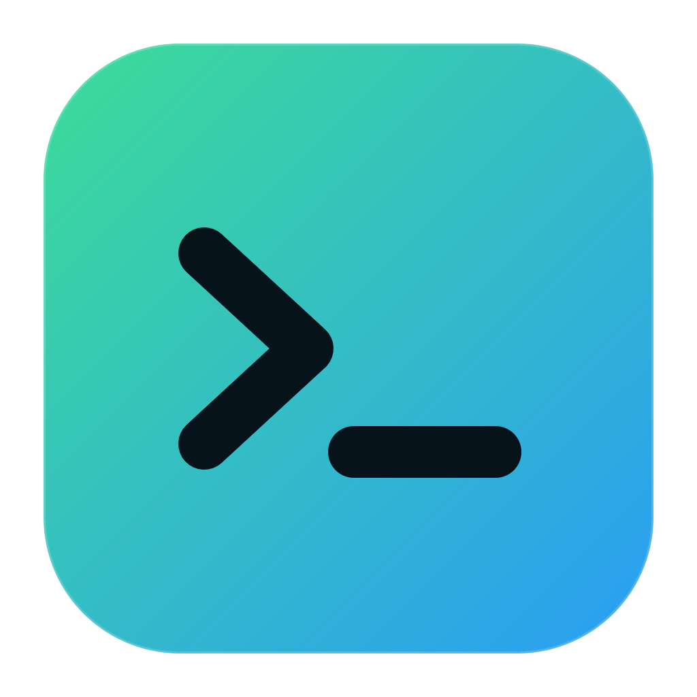</p>

# SSHbar

**SSH + *bar*, Romanian for pub: the place where all your servers meet.**

A cross-platform SSH client for Linux, Windows and Android: terminal, file manager, port forwarding, jump hosts and live server stats. It integrates with Proton Pass and syncs between your devices through an encrypted file, with no server or account.

<p align="center"><a href="docs/media/hero.png">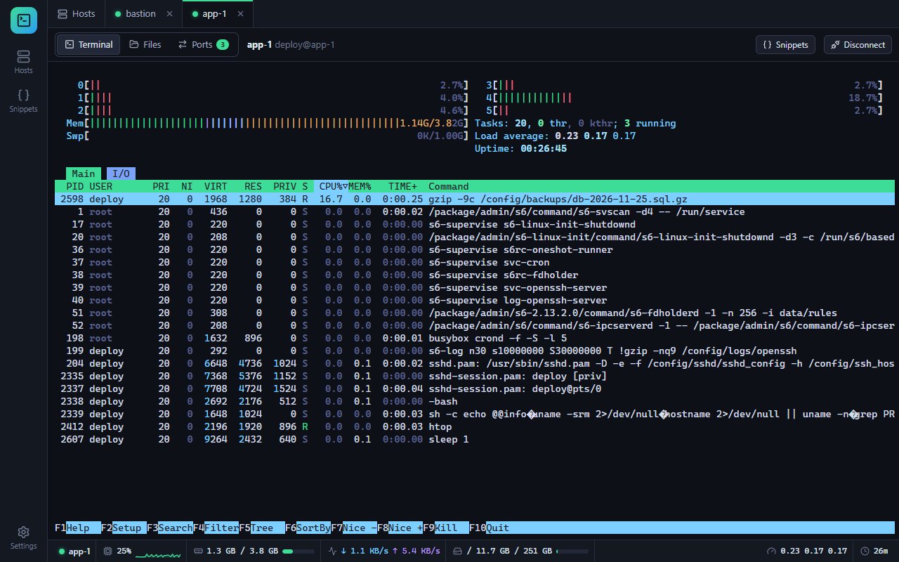</a></p>

**[⬇ Download the latest release](../../releases/latest)** · [All versions](../../releases) · [nicuorlov.com](https://nicuorlov.com)

| Platform | File |
|---|---|
| Linux | `SSHbar-<version>-x86_64.AppImage` (make it executable and run), or `sshbar_<version>_amd64.deb` |
| Windows | `SSHbar-Setup-<version>-x64.exe` (installer) or `SSHbar-<version>-portable-x64.exe` (no install) |
| Android 8+ | `SSHbar-<version>-android.apk`: open it on the phone and allow installing from your browser/files app |

The Windows builds aren't code-signed yet, so SmartScreen may warn: choose *More info → Run anyway*.

At startup SSHbar asks GitHub for the latest release and shows a notice with a download link when there is a newer one. It never downloads or installs anything by itself. Turn the check off, or run it by hand, under *Settings → About*.

## Features

| | | |
|---|---|---|
| **Cross-platform** | Windows, macOS and Linux (Electron). Installers via electron-builder: NSIS, DMG, AppImage/deb. | <a href="docs/media/android.png">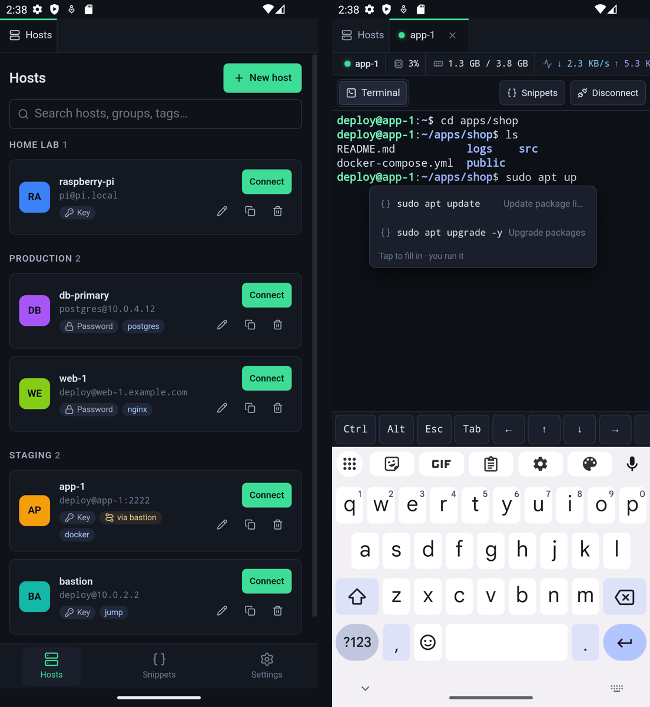</a> |
| **Central host list** | Hosts with groups, tags, notes and search. Import from `~/.ssh/config` or JSON. Share them between your computers **without a server**, either through an **encrypted sync file** in any folder you already sync, or through **Proton Pass**. | <a href="docs/media/hosts.png">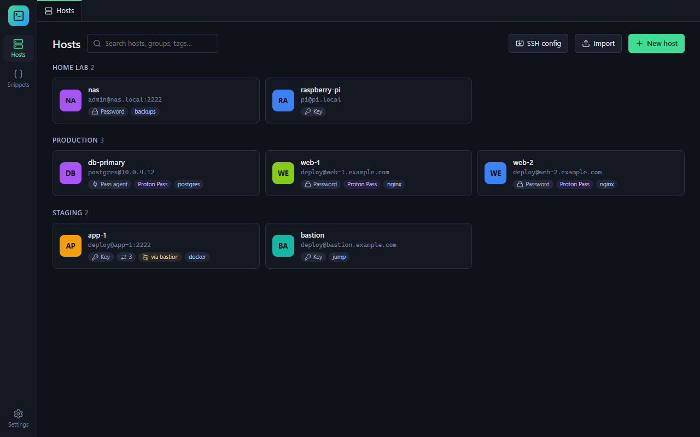</a> |
| **Jump hosts** | Reach private servers through a bastion (ProxyJump). Chains like A → B → C work, every hop's host key is verified, and loops are detected. `ProxyJump` entries in `~/.ssh/config` are mapped when importing. | <a href="docs/media/jump-host.gif">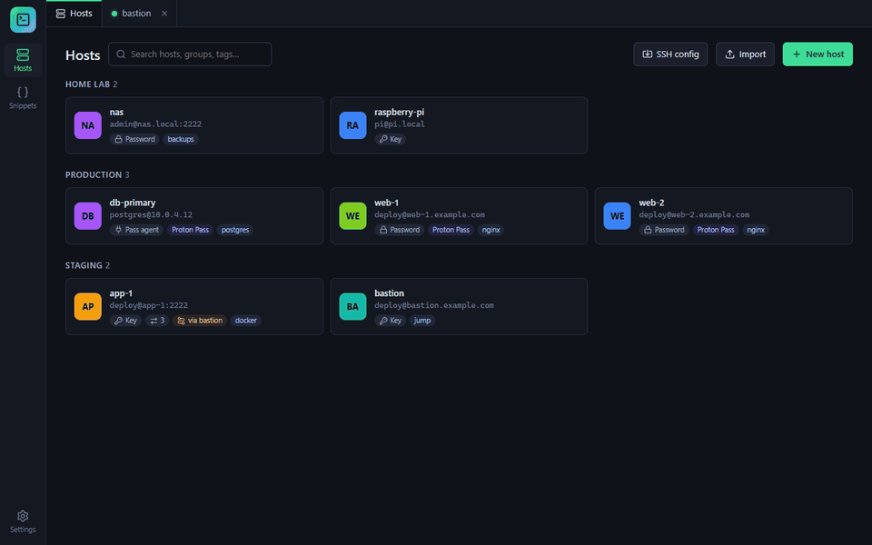</a> |
| **Port forwarding** | Local (`-L`), remote (`-R`) and dynamic SOCKS5 (`-D`) forwards, saved per host and optionally started on connect. A Ports tab shows live status and connection counts. Listeners bind to `127.0.0.1` unless you choose otherwise, with a warning. `LocalForward`/`RemoteForward`/`DynamicForward` lines are imported from `~/.ssh/config`. | <a href="docs/media/ports.png">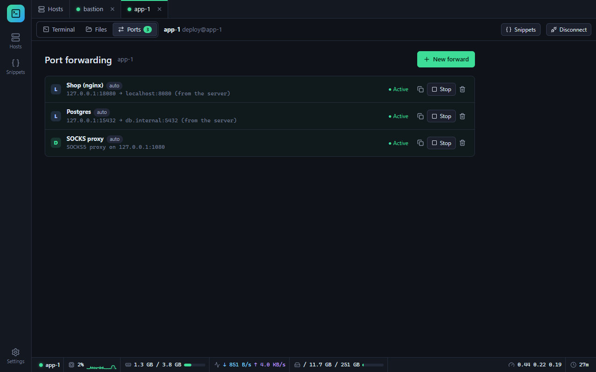</a> |
| **Authentication** | Password, SSH key (file, pasted, or from Proton Pass), SSH agent (system, Proton Pass agent, custom socket), plus keyboard-interactive / 2FA prompts. Encrypted keys are supported. If a key is rejected it falls back to asking for a password, like OpenSSH. | <a href="docs/media/host-editor.png">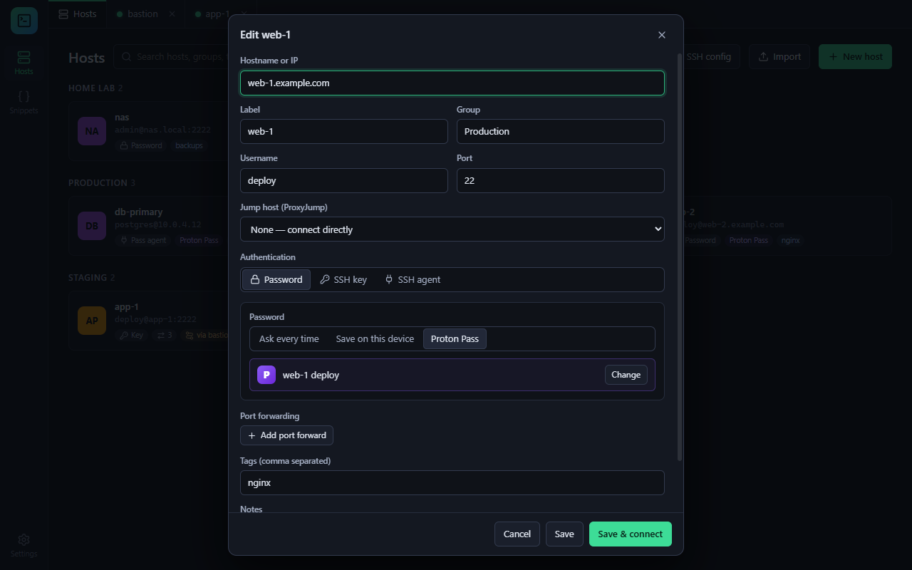</a> |
| **Proton Pass** | Passwords come from Login items and keys from SSH Key items, fetched on demand via `pass-cli` and kept in memory only. The `pass-cli ssh-agent` daemon can be started from the app. Host sync uses a Proton Pass note. |  |
| **Terminal** | xterm.js with 256 colours and truecolor, clickable links, copy/paste, multiple tabs and reconnect. Search the scrollback with `Ctrl+Shift+F` (`⌘F` on macOS). | <a href="docs/media/hero.png"></a> |
| **Snippets** | Saved commands, pasted or run in the current session from a palette (`Ctrl+Shift+S`). Multi-line snippets use bracketed paste. Snippets sync along with your hosts. While you type a command, matching snippets are offered after 3 letters (`sudo apt up` → `sudo apt update`, `sudo apt upgrade`): pick one with `↑` `↓` and `Enter`, click it, or tap it on Android. It is only filled in, you run it. Off switch under *Settings → Terminal*. | <a href="docs/media/snippet-palette.png">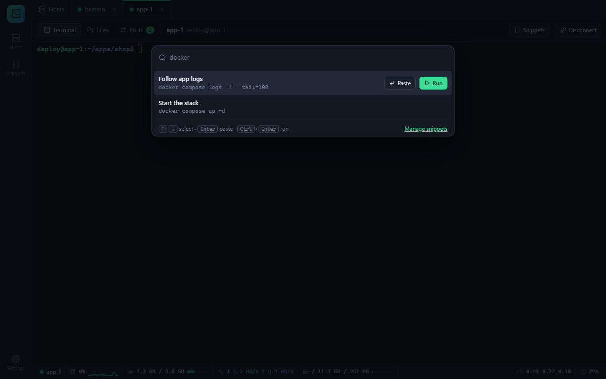</a> |
| **File manager** | Dual-pane local ↔ remote SFTP browser. Drag & drop between panes or from the OS, upload/download of files *and folders*, rename, new folder, delete, and a transfer queue with progress, speed and cancel. | <a href="docs/media/files.png">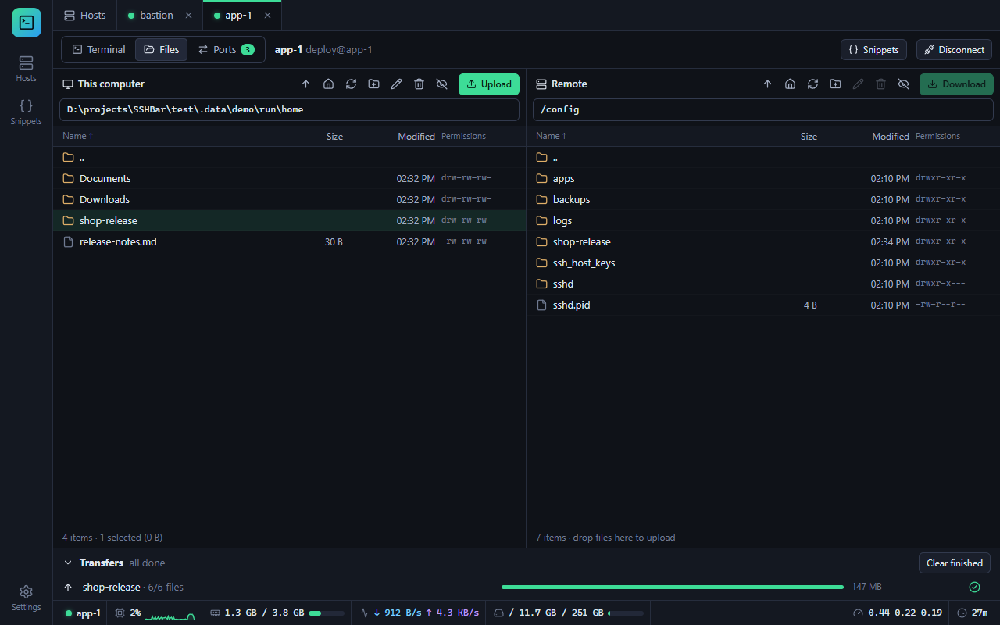</a> |
| **Live stats (bottom panel)** | CPU % with sparkline, RAM (and swap), network ↓/↑ throughput, disk usage per mount, load average and uptime. Read from `/proc` over the existing connection, so nothing is installed on the server. |  |
| **Security** | Trust-on-first-use host key verification with a loud warning when a key changes. `~/.ssh/known_hosts` is honoured (read-only). Secrets saved on a device are encrypted with the OS keychain. Sandboxed renderer with a strict CSP. |  |

## See it in action

**Snippet suggestions while you type.** After three letters, matching snippets appear by the cursor. Pick one and it is filled in; you still press Enter to run it.

<p align="center">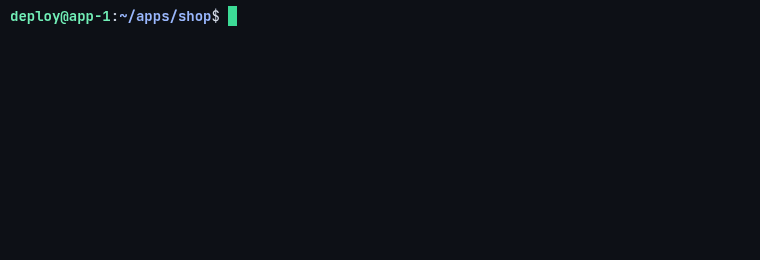</p>

**A private server through a jump host.** `app-1` is only reachable from inside the network, so SSHbar goes through `bastion` first and checks each server's host key on the way.

<p align="center"></p>

**Upload a folder** and follow it in the transfer queue.

<p align="center">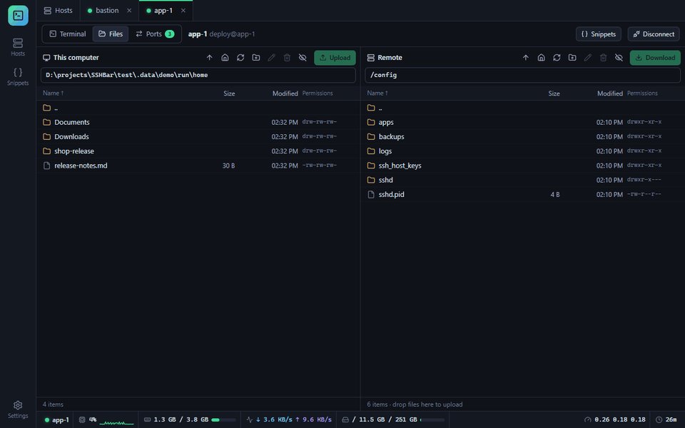</p>

The screenshots are made by `npm run demo` against throwaway demo servers in Docker, with made-up hosts and files ([`scripts/demo.cjs`](scripts/demo.cjs)).

## Building from source

```bash
npm install
npm run dev          # run with hot reload
npm run build && npm start   # run the production build
```

Requires Node 20+ (tested with Node 24). With npm 11 the Electron binary downloads on first run.

## Importing from Termix

**Hosts → Import** accepts a Termix host export directly. Folders become groups, and usernames from Termix credentials are kept. Termix exports contain no passwords or keys, so password hosts ask on first connect (tick *Save on this device*). Hosts that used a key get a note naming the Termix credential.

To give all key-based hosts a Proton Pass SSH key in one go, convert first:

```bash
node --no-warnings scripts/convert-termix.mjs termix-hosts.json sshbar-hosts.json --pp-key "Personal/My SSH Key"
```

Then import `sshbar-hosts.json`. Only the Proton Pass item reference is written, never the key. Importing the same hosts twice skips the duplicates.

## Sharing hosts between devices (no server)

### Encrypted sync file (recommended)

**Settings → Encrypted sync file → Create sync file…** and save it in a folder that syncs between your computers: Dropbox, OneDrive, iCloud Drive, Google Drive, Syncthing, Proton Drive, a NAS share, or a USB stick. Choose a master password. On your other computers, use **Use existing sync file…** and enter the same password.

- The file is a JSON envelope: scrypt (N=2¹⁷, r=8) derives a key from the master password, and AES-256-GCM encrypts the content. The header is authenticated too. Without the password the file shows nothing, not even host names.
- It can include the passwords, keys and passphrases you saved on a device (on by default, per-device toggle). A device with the toggle off still leaves other devices' secrets in the file alone.
- Every device keeps its own local copy and works offline. When the file changes, it merges per host (newest edit wins, deletions propagate). It notices changes through a file watcher, plus a 30 s poll for network shares.
- The master password can be remembered in the OS keychain, so you type it once per device. After a password change, other devices show "locked" until you enter the new one.
- An existing file is never overwritten. Pointing a new device at it with the wrong password just fails.

### Proton Pass sync

See below. The host list goes into a Proton Pass note, and secrets stay as references to Proton Pass items.

## Proton Pass integration

Install the [Proton Pass CLI](https://proton.me/pass) and log in once in a terminal:

```bash
pass-cli login
```

Then in **Settings → Proton Pass**, press *Check*. GUI apps on macOS don't inherit your shell `PATH`, so SSHbar also looks in `~/.local/bin`, `/opt/homebrew/bin` and `/usr/local/bin`. If `pass-cli` lives somewhere else, set the full path there.

| What | How it's used |
|---|---|
| Password from Proton Pass | In the host editor choose *Password → Proton Pass* and pick a Login item. At connect time SSHbar runs `pass-cli item view --output json` and uses the item's password. |
| SSH key from Proton Pass | Choose *SSH key → Proton Pass* and pick an SSH Key item. If the key is encrypted, a custom field named `passphrase` on the item is used automatically. Otherwise you're asked once, and can save the passphrase on the device. |
| Proton Pass SSH agent | Choose *SSH agent → Proton Pass agent*. SSHbar runs `pass-cli ssh-agent daemon start --socket-path …` if the agent isn't running. |
| Host sync | **Settings → Sync hosts through Proton Pass** → pick a vault. SSHbar creates a note named **"SSHbar Sync"** and stores the host list in its `sshbar_hosts` field (gzip+base64 when large). Each device merges per host, newest change wins, and deletions propagate. |

Secrets fetched from Proton Pass are never written to disk. The sync payload contains host details and **references** (Proton Pass item IDs, key file paths, "saved on this device" markers), never passwords or keys.

## Where data lives

All files are in the app data directory (`~/.config/SSHbar` on Linux, `%APPDATA%\SSHbar` on Windows, `~/Library/Application Support/SSHbar` on macOS). They're written atomically with mode `0600`.

| File | Contents |
|---|---|
| `hosts.json` | Host list plus deletion tombstones (for sync). No secrets. |
| `secrets.json` | Passwords, keys and passphrases you chose to *save on this device*, encrypted with Electron `safeStorage`: macOS Keychain, Windows DPAPI, or libsecret/KWallet on Linux. If Linux has no keyring, saving is disabled instead of falling back to plain text. |
| `known_hosts.json` | Host keys you trusted in SSHbar. |
| `settings.json` | Preferences. |
| *your sync file* | Optional, wherever you put it. Encrypted with your master password. |

Set `SSHBAR_DATA_DIR` to use a different directory, for example for a portable install or tests.

## Packaging

| Command | Output (in `dist/`) |
|---|---|
| `npm run dist:linux` | `SSHbar-<version>-x86_64.AppImage`: a single executable (`chmod +x`, then run). `sshbar_<version>_amd64.deb`: installs to `/opt/SSHbar` with a `sshbar` command, a menu entry and the AppArmor profile Ubuntu 24.04+ needs. |
| `npm run dist:win:docker` | `SSHbar-Setup-<version>-x64.exe` (installer with Start-menu and desktop shortcuts and an uninstaller) and `SSHbar-<version>-portable-x64.exe` (no install). Built on Linux inside electron-builder's official Docker image, which brings its own Wine. |
| `npm run dist:win:portable` | Only the portable `.exe`. Needs no Wine or Docker. |
| `npm run dist:win` | Both Windows files, when run on Windows (or Linux with Wine installed). |
| `npm run dist:mac` | DMG. Build on macOS; sign and notarize for distribution. |
| `npm run dist:all` | Linux and Windows packages in one go. |

The Windows executables aren't code-signed, so SmartScreen shows *"Windows protected your PC"* on first run (*More info → Run anyway*). Set `CSC_LINK`/`CSC_KEY_PASSWORD` (or Azure Trusted Signing) to sign them.

## Tests

```bash
npm test             # unit tests: stats parser, known_hosts, sync merge, encrypted sync file (multi-device), ssh_config import, Proton Pass parsing
npm run test:it      # starts OpenSSH servers in Docker (scripts/it-server.sh) and runs SSH/SFTP/jump-host integration tests
npm run test:smoke   # headless Electron run: connect, type in the terminal, open files/settings, save screenshots
                     # set ELECTRON_RENDERER_URL=<vite dev server url> to run it against React dev mode (StrictMode)
SSHBAR_PP_LIVE=1 npx vitest run test/protonpass.live.test.ts   # read-only checks against your real pass-cli
```

On Windows, Hyper-V may reserve port 2222: start the servers on another one, e.g. `SSHBAR_IT_PORT=22022 scripts/it-server.sh`, and pass `SMOKE_PORT=22022` to the smoke run.

### README screenshots

```bash
scripts/demo-servers.sh        # Docker: "bastion" on 127.0.0.1:22 (SSHBAR_DEMO_PORT to change) and "app-1" behind it
npm run demo                   # drives the real app and writes docs/media/*.png and *.gif (GIFs need ffmpeg)
scripts/demo-servers.sh stop
```

Everything shown is demo data: a fresh data folder with made-up hosts and snippets, and a demo folder standing in for "this computer", so your own hosts, keys and files never appear. `bastion.example.com` is pointed at the local container inside the demo process only. Opens a window on Windows and macOS for about a minute; on Linux add `--ozone-platform=headless`.

The integration suite covers port forwarding (local, remote and SOCKS5 with server-side name resolution, auto-start, port-in-use errors), jump hosts (to a server that is only reachable through the bastion), password, retry and cancel, plain and encrypted keys, keys from Proton Pass, key-to-password fallback, host-key change detection, connection-refused errors, live stats, and SFTP folder upload/download round-trips with byte-level comparison and cancellation. Host sync runs against a fake `pass-cli` (`test/fixtures/fake-pass-cli.mjs`) that simulates two devices.

## Architecture

```
src/
  shared/            types + the preload API contract (SSHbarApi)
  main/              Electron main process (all network, file and secret access)
    index.ts         window, IPC handlers (sender-checked), prompt broker, sync scheduling
    ssh/session.ts   one SSH connection: auth state machine, host-key check, shell, stats channel, SFTP channels
    ssh/stats.ts     remote stats script + /proc parser (CPU/RAM/net deltas, df)
    ssh/sftp.ts      SFTP helpers and transfer planning
    transfers.ts     transfer queue (3 parallel jobs, each on its own SFTP channel so cancel = close channel)
    protonpass.ts    pass-cli wrapper (execFile, never a shell)
    sync.ts          Proton Pass host sync (merge, tombstones, compression)
    sshconfig.ts     ~/.ssh/config import (Include, wildcards, first-match-wins)
    store/           hosts, encrypted secrets, settings, known hosts
  preload/index.ts   contextBridge → window.sshbar
  renderer/src/      React UI (zustand store, xterm terminal, file panes, stats bar, dialogs)
```

The renderer runs sandboxed with `contextIsolation` and has no Node access. Saved secrets never travel to it. Terminal output goes over IPC straight into xterm, bypassing React state.

## Known limitations / next steps

- `ProxyCommand` isn't supported; imported hosts that use it get a note. The SOCKS proxy supports SOCKS5 CONNECT only (no SOCKS4, no UDP).
- Live CPU/RAM/network stats need a Linux server. macOS/BSD hosts show disk usage only.
- Only run-tested on Linux. The Windows installer and portable `.exe` are built and contain the app's icon and version info, but they haven't been run on Windows yet. macOS builds are configured but unverified.
- Proton Pass sync was tested against a simulated CLI. Its write commands (`item create note`, `item update --field`) come from `pass-cli --help` but haven't been run against a real vault yet.
- Android doesn't have the file manager, port forwarding or imports yet. Its NAS option needs SMB 2 or newer and a username for SMB 2-only servers. No split panes or broadcast-to-many-sessions.

## Releases

Pushing a version tag builds and publishes a release automatically ([`.github/workflows/release.yml`](.github/workflows/release.yml)):

```bash
git tag v0.2.0 && git push origin v0.2.0
```

GitHub Actions runs the tests, builds Linux (AppImage, .deb), Windows (installer, portable) and Android (signed APK) on native runners, and attaches the files and a `SHA256SUMS.txt` to a new release named after the tag.

The APK is signed with the project's release key, supplied as repository secrets (Settings → Secrets and variables → Actions): `ANDROID_KEYSTORE_BASE64`, `ANDROID_KEYSTORE_PASSWORD` and `ANDROID_KEY_ALIAS`. Without them the release still publishes, just without the APK. Keep the keystore backed up: updates only install over an app signed with the same key. The version inside the apps comes from the tag. A tag with a suffix such as `v0.2.0-beta.1` is published as a pre-release.

## Android app

The phone app shares the desktop's screens and its host model, with SSH done natively by [sshj](https://github.com/hierynomus/sshj). It has terminal, live stats, jump hosts, password, key and 2FA logins, snippets, and the encrypted sync file, either on a NAS share it opens itself (SMB 2/3 through [smbj](https://github.com/hierynomus/smbj)) or through Android's file picker. To get your desktop hosts on the phone:

1. On the computer: **Settings → Encrypted sync file**. Hosts that use Proton Pass keys or passwords need **Share Proton Pass keys and passwords with my phones** turned on, because phones have no Proton Pass CLI.
2. On the phone: **Settings → Encrypted sync file**, then
   - file on a NAS or Windows share: **On a NAS (SMB)…** Enter the NAS address, share, username and password (or paste a path like `\\192.168.0.10\share\folder`), tap through to the file and enter the master password. SMB 3 connections are encrypted.
   - file in a cloud drive: **Use existing sync file…** and tap ☰ in the picker to see Drive, Dropbox, OneDrive and Proton Drive. An app that is missing there may have been switched off by Android for not being used: turn it back on in the phone's **Settings → Apps**.

Passwords and keys saved on the phone, including the NAS password, are encrypted with the Android Keystore. They never change the host settings shared with your computers.

Debug builds install as a separate app ("SSHbar dev", `com.nicuorlov.sshbar.dev`) next to the released one. `scripts/smb-server.sh` starts a disposable Samba server for testing the NAS option (`adb reverse tcp:4450 tcp:4450`, then address `127.0.0.1:4450`).

Building from source:

```bash
JAVA_HOME=<JDK 21> ANDROID_HOME=<Android SDK> npm run android:apk   # debug APK in android/app/build/outputs/apk/debug/
```

## Contact & license

Made by Nicolae Orlov, [nicuorlov.com](https://nicuorlov.com), contact@nicuorlov.com. Report security issues privately as described in [SECURITY.md](SECURITY.md).

Released under the [MIT license](LICENSE).

